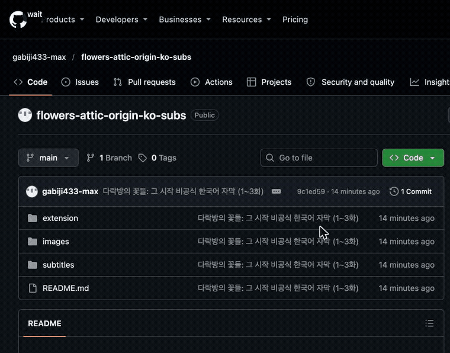
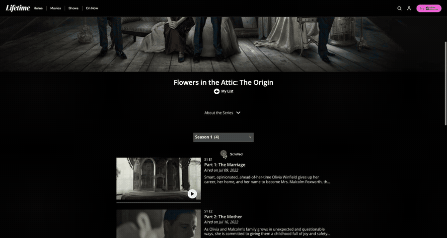
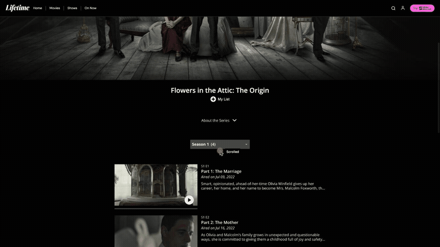
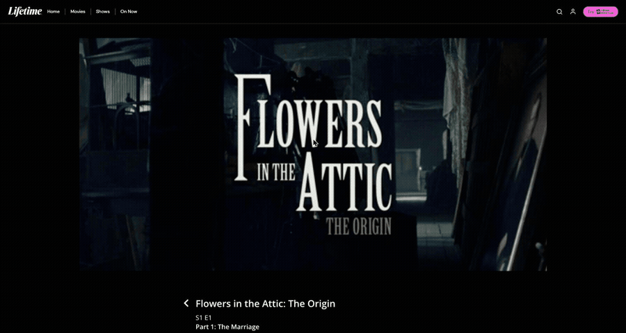
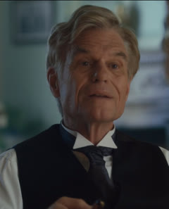
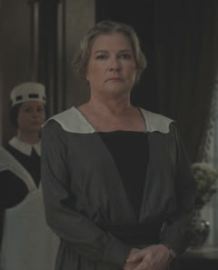

<p align="center"></p>

# 다락방의 꽃들: 그 시작 — 한국어 자막

미국 Lifetime 드라마 **Flowers in the Attic: The Origin** (2022, 4부작) 비공식 한국어 자막.
국내 정식 공개 전이라 직접 번역한 팬 자막. Lifetime 재생 화면 위에 한국어 자막을 띄우는 크롬 확장 포함.

- 현재 공개 범위: **1화 (Part 1: The Marriage), 2화 (Part 2: The Mother), 3화 (Part 3: The Murderer), 4화 (Part 4: The Martyr)** — 전편 공개 완료

## 만든 이유

언어의 장벽 때문에 이 갓작을 못 본다고? 그럴 순 없음…<br>
제작자가 자신 있게 추천하는 **찐맛집 드라마**, 자막까지 차려 놓음. 🍽️

- 국내 정식 공개는 아직 감감무소식 → 기다리다 지쳐서 직접 번역

## 📌 제작자의 당부

> **꼭꼭!! 1화부터 볼 것.**
> 제작자처럼 특정 장면 보겠다고 2화부터 틀었다가 후회하지 말고… ㅠㅠ
> 이 드라마는 **무조건 1화부터** 봐야 함. 1화에서 쌓아 올린 이야기가 뒤에서 전부 돌아옴.

## 🐣 처음이라면: 그림으로 따라 하기

프로그램 몰라도 괜찮음. 아래 순서대로 따라 하면 됨. (크롬 브라우저 기준, 약 5분)

### ① 자막 파일 받기
- 이 페이지 위쪽 초록색 **`<> Code`** 버튼 → **Download ZIP**
- 받은 ZIP 파일을 더블클릭해서 압축 풀기



### ② 크롬에 자막 확장 설치하기
- 크롬 주소창에 `chrome://extensions` 입력 후 Enter
- 오른쪽 위 **개발자 모드** 스위치 켜기
- 왼쪽 위 **압축해제된 확장 프로그램 로드** → 압축 푼 폴더 안의 **`extension`** 폴더 선택
- 주소창 오른쪽 퍼즐 조각(🧩) → 📌 눌러서 고정해 두면 편함


### ③ Lifetime에서 드라마 틀기
- 시청 페이지: [Flowers in the Attic: The Origin — Lifetime](https://play.mylifetime.com/shows/flowers-in-the-attic-the-origin)
- 미국 서비스라 한국에서는 바로 접속 안 됨 → 미국 VPN으로 접속
- 💡 제작자 경험상: 영상이 재생되기 시작하면 VPN을 꺼도 계속 볼 수 있었음. VPN 켠 채로 보면 화질이 많이 떨어지니 참고. (환경에 따라 다를 수 있음)



VPN 없이 재생하면 아래처럼 **Geographic restriction**(지역 제한)이 뜸.



### ④ 한글 자막 켜기
- 영상이 나오면 고정해 둔 확장 아이콘 클릭 (또는 `Option+Shift+S`, 윈도우는 `Alt+Shift+S`)
- 왼쪽 위 패널에서 **화수** 고르기
- 자막이 어긋나면 `S` → 방금 들린 대사 클릭



## 적용 방법

### 1. 크롬 확장 설치 (영상 위에 자막 띄우기)

1. 이 저장소를 내려받기 (`Code` → `Download ZIP` 후 압축 해제)
2. 크롬 주소창에 `chrome://extensions` 입력
3. 오른쪽 위 **개발자 모드** 켜기
4. **압축해제된 확장 프로그램 로드** → `extension` 폴더 선택
5. Lifetime에서 영상 재생 → 툴바의 확장 아이콘 클릭 (또는 `Option+Shift+S`, 윈도우는 `Alt+Shift+S`) → 자막 표시 시작

### 2. 영어 + 한글 함께 보기

- 기본 표시: 한글 자막 아래에 영어 원문이 작게 함께 표시
- 패널 메뉴 또는 `K` 키로 **영어+한글 / 한글만** 전환
- 자막이 화면 요소와 겹치면 패널의 **▲ 위로 / ▼ 아래로**로 높이 조절 (설정 자동 저장)

### 3. 자막 맞추기

| 키 | 기능 |
|---|---|
| `S` | 싱크 맞추기 — 목록에서 방금 들린 대사 클릭 |
| `[` `]` | 자막 0.5초 앞/뒤로 (`Shift`와 함께 누르면 5초) |
| `H` | 자막 잠시 끄기 |
| `K` | 영어+한글 / 한글만 전환 |
| `P` | 조작 패널 열기/닫기 |

- 맞춘 싱크는 에피소드별로 자동 저장
- 단축키가 안 먹으면 영상을 한 번 클릭한 뒤 다시 시도. 패널 버튼으로도 같은 기능 사용 가능

### 4. 광고 대응 (자동)

Lifetime은 회차마다 광고가 여러 번 나옴. 확장이 광고를 알아보고 알아서 처리함.

| 기능 | 하는 일 | 패널 위치 |
|---|---|---|
| **광고 자동 보정** | 광고 중엔 한글 자막 숨김, 광고가 끝나면 광고 시간을 빼고 자막 싱크 자동 유지 | ☑ 광고 자동 보정 (옆에 `작동 중` / `광고 중` 표시) |
| **광고 음소거** | 광고가 시작되면 소리 끄고, 본편으로 돌아오면 다시 켜기 | ☑ 광고 음소거 |
| **광고당 보정** | 광고 앞뒤 짧은 암전 때문에 광고 하나 지날 때마다 생기는 약 1초 밀림 자동 보정 | 광고당 `-0.5` `+1.0초` `+0.5` |

- 광고 뒤에 자막이 계속 늦게 나오면 **광고당** 값을 `+0.5`, 계속 빨리 나오면 `-0.5`
- 일부 광고(Lifetime 자체 예고편 등)는 광고로 표시되지 않아 음소거·보정이 안 될 수 있음 → 광고 뒤 `S`로 한 번 맞추기

### 🐞 음소거나 싱크가 안 될 때: 진단 복사로 제보

1. 문제가 생긴 순간(광고가 나오는 중 등) 패널의 **진단 복사** 버튼 클릭
2. 이 저장소의 [**Issues**](../../issues) → **New issue**
3. 어떤 상황이었는지 한 줄 + 복사된 진단 내용 붙여 넣기 (`⌘V` / `Ctrl+V`)

```
예) 3화 1시간쯤 "Wolf Out" 광고에서 음소거 안 됨
{ "step": "fita-diag", ... }
```

- 진단 내용에는 화수·싱크 값·광고 기록·플레이어 상태만 담기고 개인 정보는 없음

### 5. 글꼴 (선택)

- 기본 글꼴: **a시네마** (극장 영화 자막 느낌)
- 설치: [아시아폰트](http://www.asiafont.com/) → 폰트통 설치 → "시네마" 검색 → a시네마 L/M/B 설치 (개인 사용 무료)
- 미설치 시 나눔고딕·맑은 고딕 등 기본 글꼴로 표시. 패널의 **글꼴** 메뉴에서 변경 가능

### 확장 없이 쓰기

- `subtitles/e1.ko.srt` ~ `subtitles/e4.ko.srt` — 일반 SRT 자막 파일
- SRT를 불러올 수 있는 플레이어라면 그대로 사용 가능
- 출처에 따라 영상 시작 시점이 달라서 싱크 조정이 필요할 수 있음

## 작품 소개

- 원작: V. C. 앤드루스의 소설 『다락방의 꽃들』 시리즈의 프리퀄 소설 『Garden of Shadows』 (1987)
- 배경: 1910~1940년대 미국 버지니아의 대저택 **폭스워스 저택(Foxworth Hall)**
- 내용: 훗날 "다락방의 할머니"로 알려지는 올리비아 폭스워스가 어떻게 그런 사람이 되었는지에 대한 이야기
- 원작 『다락방의 꽃들』을 몰라도 감상에 지장 없음

## 등장인물 (스포 없음)

출연·배역: [IMDb — Flowers in the Attic: The Origin (2022)](https://www.imdb.com/title/tt17527896/fullcredits/)

| 극중 사진 | 인물 | 배우 | 소개 |
|:---:|---|---|---|
|  | **올리비아 윈필드 폭스워스**<br>Olivia Winfield Foxworth | [제미마 루퍼](https://www.imdb.com/find/?q=Jemima%20Rooper) (Jemima Rooper) | 이 이야기의 주인공이자 화자. 뉴런던에서 아버지와 함께 해운 사업을 꾸려 온 영리하고 당찬 여성. 책을 사랑하고, 연애보다 일을 택하며 살아왔다 |
|  | **맬컴 닐 폭스워스**<br>Malcolm Neil Foxworth | [맥스 아이언스](https://www.imdb.com/find/?q=Max%20Irons) (Max Irons) | 버지니아 폭스워스 광산 재벌의 유일한 상속자. 세련되고 자신감 넘치는 신사로, 사업차 올리비아의 아버지를 찾아온다 |
|  | **윈필드 씨**<br>Mr. Winfield | [해리 햄린](https://www.imdb.com/find/?q=Harry%20Hamlin) (Harry Hamlin) | 올리비아의 아버지. 아들 대신 딸을 사업 동업자로 키운, 딸바보 아버지 |
|  | **갈랜드 폭스워스**<br>Garland Foxworth | [켈시 그래머](https://www.imdb.com/find/?q=Kelsey%20Grammer) (Kelsey Grammer) | 맬컴의 아버지. 은퇴 후 세계를 누비며 인생을 즐기는 유쾌한 노신사 |
|  | **앨리샤 폭스워스**<br>Alicia Foxworth | [앨라나 보든](https://www.imdb.com/find/?q=Alana%20Boden) (Alana Boden) | 갈랜드의 젊은 새 아내. 밝고 다정해서 폭스워스 저택에 처음으로 웃음을 들고 온다 |
|  | **스타이너 부인**<br>Mrs. Steiner | [케이트 멀그루](https://www.imdb.com/find/?q=Kate%20Mulgrew) (Kate Mulgrew) | 폭스워스 저택의 가정부장. 평생을 이 집에서 보냈고, 새 안주인이 영 못마땅하다 |
|  | **넬라**<br>Nella | [티샨 윌리엄스](https://www.imdb.com/find/?q=T%27Shan%20Williams) (T'Shan Williams) | 폭스워스 저택의 하녀. 낯선 저택에서 올리비아에게 처음 마음을 열어 주는 사람 |
|  | **존 에이머스**<br>John Amos | [폴 웨슬리](https://www.imdb.com/find/?q=Paul%20Wesley) (Paul Wesley) | 올리비아의 사촌 오빠. 신학 박사 과정을 밟는 독실한 청년 |

- 장소도 사실상 주인공: **폭스워스 저택(Foxworth Hall)** — 맬컴 가문이 대대로 살아온 버지니아의 대저택. 전기도 들어오지 않는, 어둡고 차가운 집
- 2화 이후 등장인물은 스포일러라 소개에서 제외
- 사진: 1화 장면 캡처

## 번역 원칙

<details>
<summary>⚠️ 스포일러 주의 — 펼쳐서 보기 (인물 관계와 말투 변화에 대한 내용 포함)</summary>

| 원칙 | 이유 |
|---|---|
| 1910~20년대 상류층 말투 | 1차 세계대전 전후 미국 남부 명문가가 배경. 요즘 말투를 쓰면 시대극 분위기가 깨짐 |
| 맬컴 → 아내: 하오체 ("알아들었소?") | 겉으로는 존대지만 위에서 내려다보는 말투. 가부장적인 성격과 시대감을 함께 살리기 위함 |
| 맬컴 → 하인·자식: 반말 | 아내와 나머지 사람들을 대하는 거리감 차이를 드러내기 위함 |
| 올리비아의 말투 변화 | 남편과의 관계와 힘의 균형이 바뀔 때마다 존댓말과 반말이 바뀜. 대사보다 말투가 먼저 상황을 알려 주도록 의도 |
| 스타이너 부인: 반존대 | "마님" 하고 높이면서도 말끝마다 은근히 비꼬는 말투. 새 안주인을 못마땅해하는 오래된 가정부장의 성격 |
| 버지니아 억양은 사투리로 옮기지 않음 | 남부 억양은 시골스러움이 아니라 대대로 땅을 물려받은 상류층의 말투. 한국어 사투리로 옮기면 인물이 우스워져서 하오체 등 옛 말투로 대신 표현 |
| 독백은 *이탤릭* | 화면 속 대화와 올리비아의 회상 독백을 구분하기 위함 |
| 효과음 표시 생략 | [천둥], [문 두드리는 소리] 등은 화면과 소리로 충분히 전달됨. 자막은 대사에 집중 |

</details>

- 오역·어색한 표현 제보는 이슈로 남기면 반영

## 알림

- 비공식 팬 번역. 개인 감상 용도로만 사용 부탁
- 영상 파일은 포함하지 않음
- 작품의 모든 권리는 원저작권자(Lifetime / A+E Networks 등)에게 있음
- 권리자 요청 시 즉시 내림
- 저작권 관련 문의·게시 중단 요청: **gabiji433@gmail.com**
- 국내 정식 서비스가 시작되면 이 자막은 내리고 정식 서비스를 안내할 예정
